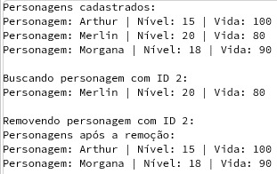
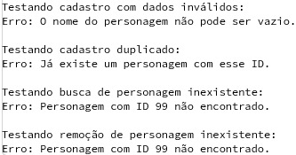

# Gerenciador de Personagens em Java

## Descrição

Projeto desenvolvido em Java para a atividade de Collections Framework e Tratamento de Exceções.

O sistema permite cadastrar, listar, buscar e remover personagens, utilizando uma coleção para armazenar os objetos durante a execução do programa.

Cada personagem possui:
- ID
- Nome
- Nível
- Vida

## Estrutura do projeto

- `model`: contém a classe `Personagem`.
- `collections`: contém a classe `PersonagemRepository`, responsável pelo gerenciamento dos personagens.
- `exceptions`: contém as exceções personalizadas utilizadas pelo sistema.
- `Main.java`: classe principal, responsável por executar e demonstrar as funcionalidades.

## Collection utilizada

Foi utilizada a coleção `ArrayList` para armazenar os personagens.

A escolha foi feita pela facilidade de adicionar e remover elementos, pelo tamanho dinâmico e pela possibilidade de percorrer os elementos com facilidade.

Como o projeto possui poucos registros e não exige buscas frequentes em grandes volumes de dados, o `ArrayList` atende às necessidades da aplicação.

## Tratamento de exceções

O projeto utiliza `try`, `catch`, `throw` e `throws`, além de três exceções personalizadas:

- `CadastroDuplicadoException`: lançada quando há tentativa de cadastrar um personagem com ID já existente.
- `RegistroNaoEncontradoException`: lançada quando um personagem não é encontrado durante uma busca ou remoção.
- `DadosInvalidosException`: lançada quando os dados de um personagem são inválidos, como nome vazio, nível ou vida menores ou iguais a zero.

Os erros são tratados com blocos `try-catch`, permitindo que a aplicação continue funcionando após uma situação inválida.

## Demonstração

A aplicação demonstra:
- Cadastro de personagens.
- Listagem dos personagens cadastrados.
- Busca de personagem pelo ID.
- Remoção de personagem.
- Tentativa de cadastro com dados inválidos.
- Tentativa de cadastro com ID duplicado.
- Busca de personagem inexistente.
- Tentativa de remoção de personagem inexistente.

### Execução normal

### Tratamento de exceções

## Como executar

1. Abra o projeto no BlueJ.
2. Compile as classes.
3. Execute a classe `Main`.
4. Acompanhe os resultados no terminal do BlueJ.

## Tecnologias utilizadas

- Java
- BlueJ
- Java Collections Framework
- Tratamento de exceções